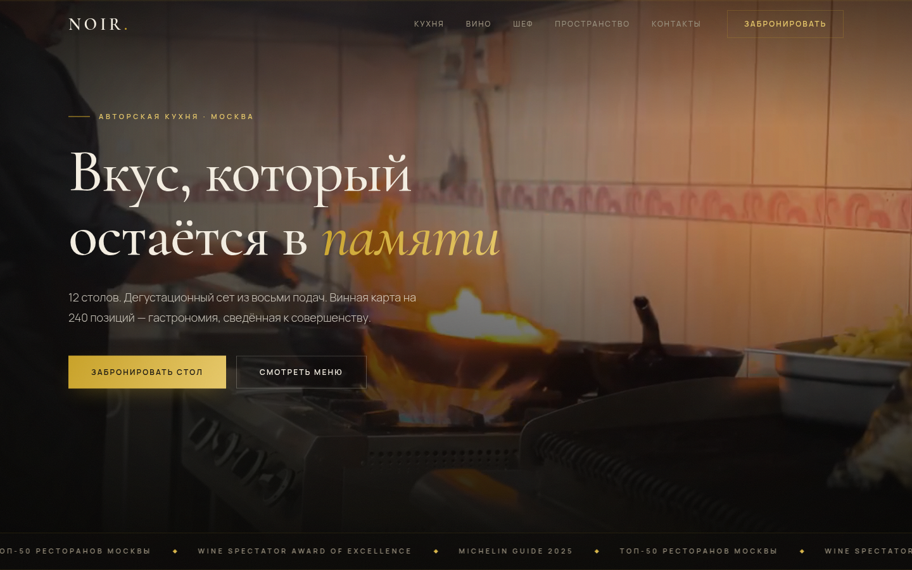
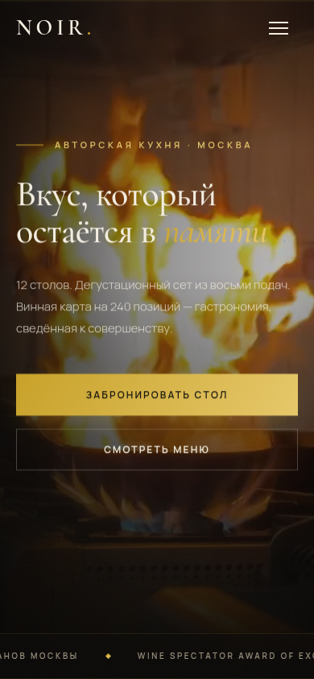

# NOIR — концепт-сайт авторского ресторана

## Демо

**[Открыть сайт →](https://shalim-andrej.github.io/noir/)**




Премиальный одностраничник вымышленного авторского ресторана NOIR: дегустационный сет, винная карта, бронирование столика. Кейс о том, как типографика, свет и медленный ритм анимаций продают атмосферу заведения ещё до того, как гость увидит еду.

**Демо:** [shalim-andrej.github.io/noir](https://shalim-andrej.github.io/noir/)

## Визуальный язык

- Чёрно-золотая палитра, приглушённый «камерный» свет
- Крупная типографика с разреженным трекингом заголовков
- Видео-обложка в первом экране
- Плёночная зернистость (grain) поверх контента и мягкие blur-слои

Каждый проект в премиум-пятёрке имеет собственную сетку и палитру — NOIR отвечает в связке за «вечернюю» эстетику высокой кухни.

## Структура страницы

| Блок | Содержание |
|---|---|
| Первый экран | видео-обложка, айдентика ресторана |
| Кухня | дегустационный сет и подача |
| Вино | винная карта |
| Шеф | лицо ресторана |
| Пространство | интерьер и посадка зала |
| Бронирование | форма: имя, телефон, дата, число гостей |

## Что внутри технически

- **HTML5-видео** в hero-секции
- **Glassmorphism** — панели и карточки на `backdrop-filter`
- **Параллакс** — слои, привязанные к скроллу
- **Reveal-анимации** на IntersectionObserver + кастомные `@keyframes`
- **CSS Grid** и кастомные свойства, fluid-типографика на `clamp()`
- **Адаптив** всех блоков, `loading="lazy"` для изображений
- **Open Graph** разметка и `meta description`
- **Ноль зависимостей** — vanilla JS, стили и скрипты написаны с нуля

## Запуск локально

```bash
git clone https://github.com/shalim-andrej/noir.git
cd noir
```

Откройте `index.html` в браузере — сборка и зависимости не нужны.

## Автор

Разработчик — Андрей Шалимов ([@shalim-andrej](https://github.com/shalim-andrej)).
Заказать сайт: [Kwork](ССЫЛКА_НА_ПРОФИЛЬ_KWORK)

> Проект демонстрационный: бренд вымышленный, сайт создан как портфолио-кейс.
